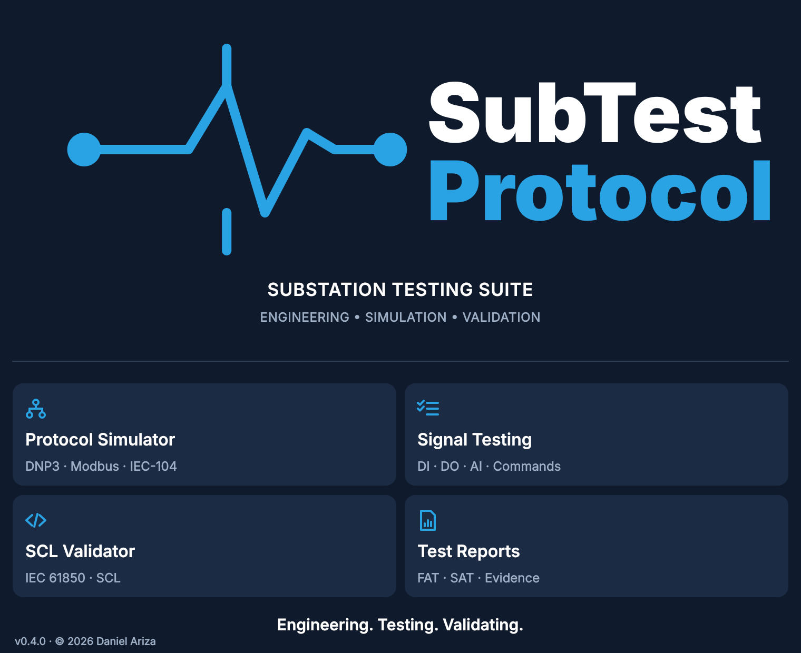
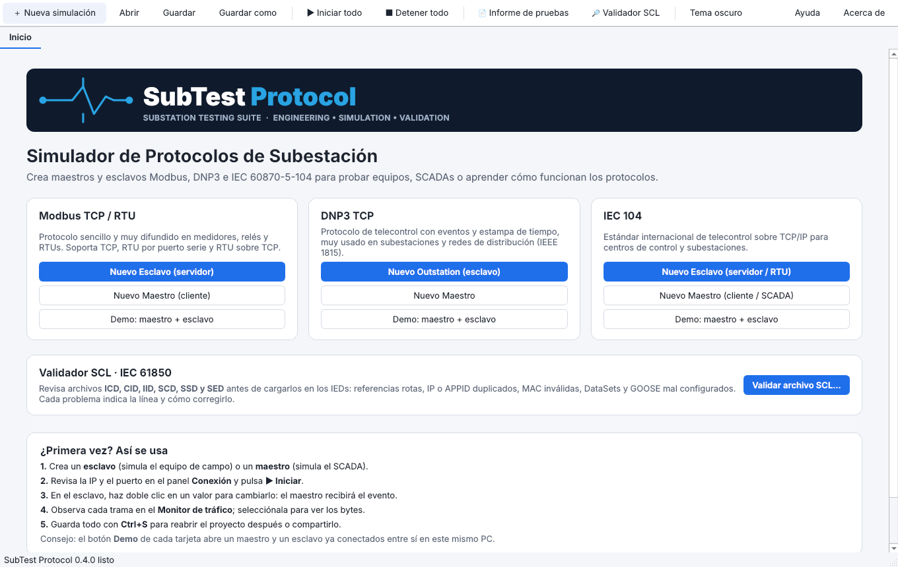
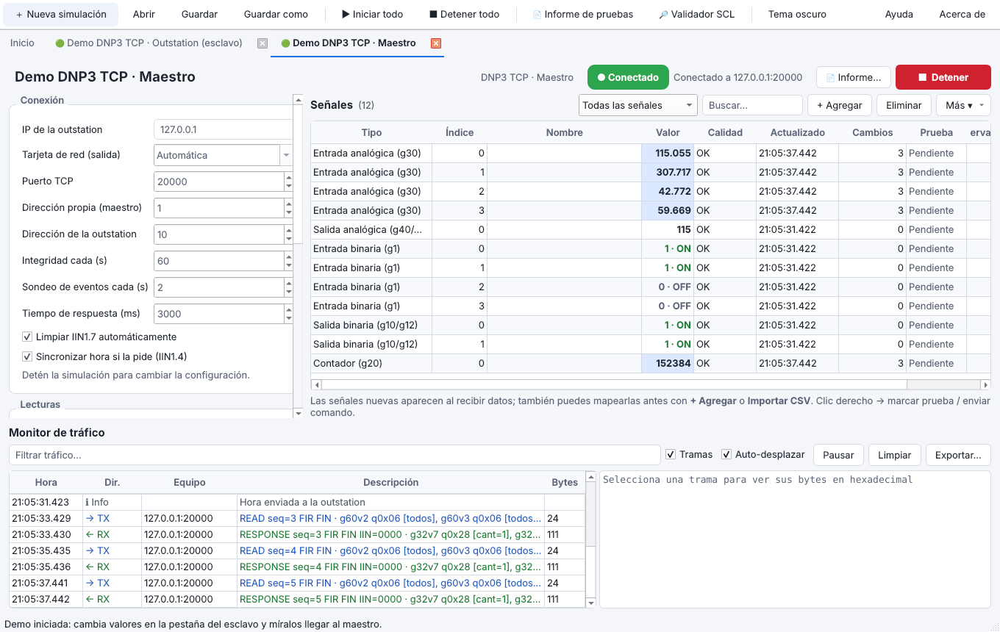
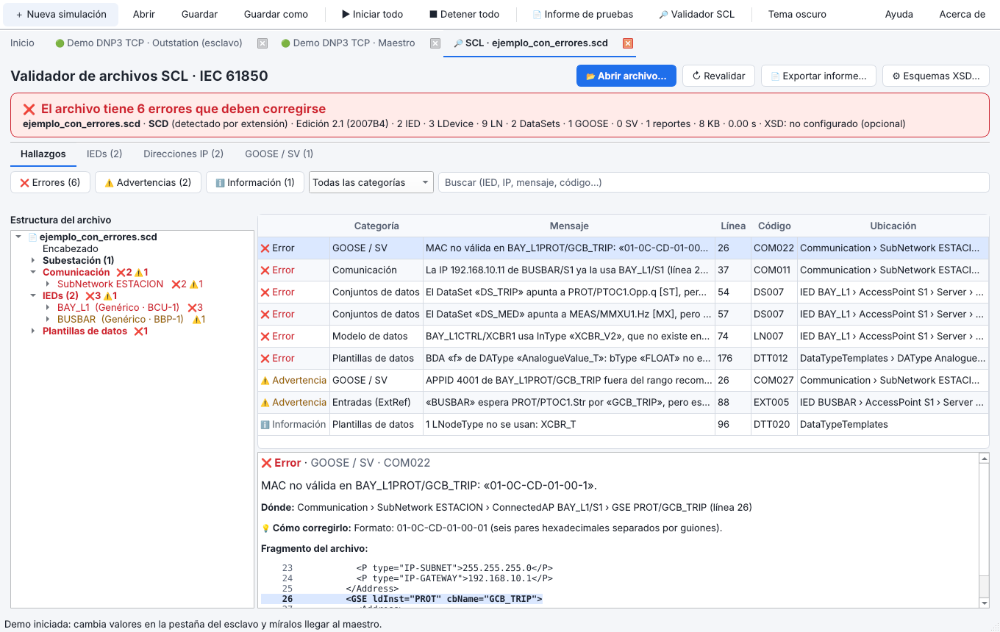

  

# SubTest Protocol · Substation Testing Suite

Aplicación de escritorio para Windows para **ingeniería, pruebas y validación de subestaciones
eléctricas**. Reúne en una sola herramienta lo que normalmente requiere varias: simular equipos y
SCADAs, probar señales punto a punto, validar archivos IEC 61850 y generar el informe de pruebas.

> 🔒 Software propietario · © 2026 Daniel Ariza. Este repositorio es una **vitrina**: muestra qué hace
> la aplicación. El código fuente es privado.

---

## Módulos

| Módulo | Qué hace |
|---|---|
| **Protocol Simulator** | Simula **maestros y esclavos** de **DNP3**, **Modbus TCP/RTU** e **IEC 60870-5-104**. Sirve para probar SCADAs, RTUs, gateways y relés sin tener el equipo real. |
| **Signal Testing** | Pruebas **punto a punto** de entradas y salidas digitales, analógicas y comandos (DI · DO · AI). Cada señal se marca OK / Falla / N/A, con observaciones. |
| **SCL Validator** | Valida archivos **IEC 61850** (ICD, CID, IID, SCD, SSD, SED). Indica cada error con su línea, dónde está y **cómo corregirlo**. |
| **Test Reports** | Genera informes de **FAT / SAT** en PDF, HTML o CSV (compatible con Excel), con resultados, evidencias y bitácora de comandos. |

---

## Capturas

### Pantalla de inicio

### Simulador de protocolos (maestro DNP3 conectado)
Tabla de señales con calidad, cambios y resultado de la prueba, y **monitor de tráfico** con cada trama
decodificada.

### Validador SCL IEC 61850
Veredicto inmediato, árbol del archivo con los errores por IED, el fragmento del XML con la línea
resaltada y la sugerencia de corrección.

---

## Funciones destacadas

**Protocolos**
- DNP3 (IEEE 1815): integridad, eventos por clases, CROB, salidas analógicas, sincronización de hora,
  Select-Before-Operate.
- IEC 60870-5-104: interrogación general, espontáneos con estampa de tiempo CP56Time2a, comandos
  simples, dobles y de consigna (con o sin selección).
- Modbus TCP, RTU serie (RS-232/485) y RTU sobre TCP: lecturas periódicas y escrituras.
- Varias sesiones simultáneas, elección de tarjeta de red y simulación automática de valores.

**Validación IEC 61850 (SCL)**
- Estructura y edición del archivo (Ed. 1, 2 y 2.1) y plantillas de datos.
- Modelo de cada IED, DataSets y bloques de control GOOSE, Sampled Values y reportes.
- Direcciones **IP duplicadas**, **MAC / APPID / VLAN** de GOOSE y SV, y suscripciones entre IEDs.
- Validación opcional contra los esquemas XSD oficiales.
- Procesa un SCD de 3 MB con 300 IEDs en menos de un segundo.

**Pruebas e informes**
- Mapeo de señales esperadas para detectar las que **no llegan**.
- Informes en PDF, HTML o CSV (compatible con Excel) con porcentaje de avance, resultados y bitácora.
- Proyectos guardables, importación y exportación de señales en CSV.

**Interfaz**
- 100 % en español, temas claro y oscuro, demo integrada y manual de usuario incluido.

---

## Tecnologías

Python · Qt (PySide6) · implementación propia de los protocolos DNP3, IEC 104 y Modbus, sin librerías
externas · instalador para Windows · compilación y pruebas automáticas con GitHub Actions.

---

## Contacto

¿Necesitas una herramienta a medida para pruebas, automatización o integración de protocolos
industriales? Escríbeme por mi perfil de **Workana**.
